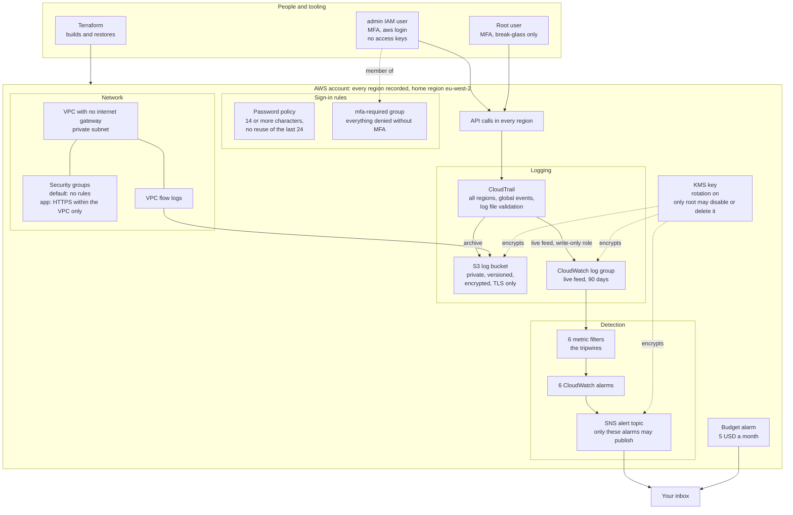

# aws-security-baseline

A hardened AWS account, built with Terraform, then tested by breaking it on purpose.

- Each control names the attack it stops
- Six detections alert when a control is broken
- Each detection was proven by staging the attack
- An incident runbook explains how to respond to an alert

## Architecture

Every management API call in every region is recorded once and kept twice: an
archive in S3 and a live, searchable copy in CloudWatch. Six tripwires watch
the live copy and alert by email. One KMS key locks the logs, the live copy and the alerts,
and only root may disable or delete it.



The break, detect and restore loop is drawn in
[`diagrams/architecture.md`](diagrams/architecture.md).

## What the staged attacks showed

1. **Configuration as code is not monitoring.** SSH was opened to the whole
   internet on a security group, and `terraform plan` reported *No changes*.
   The rules are separate Terraform resources, so Terraform only checks the
   ones it created. The detection caught it within 2.6 minutes.
2. **Prevention keeps detection alive.** One KMS key encrypts the logs, the
   live feed and the alerts, so a successful attack on that key would also
   silence the alarm meant to catch it. A key-policy deny now refuses to let
   anyone but root disable or delete the key. A deletion attempt was refused,
   the key kept working, and the refused attempt still raised an alert.
3. **The all-region trail earns its keep.** A root sign-in was recorded in
   `us-west-2`. A trail limited to the home region would never have seen it.
4. **Failed attempts are signals.** An attempt to make the log bucket public
   was refused by the account-wide block, but it was still recorded and
   raised an alert. A refused attack still tells you that someone tried.
5. **A test is only as good as its setup.** The first real "no MFA means no
   access" test let a user read data. The control was fine: the test user had
   never been put in the MFA group. Checking a test's setup is part of the
   test.
6. **Turning off the audit trail is itself recorded.** The `StopLogging` call
   happens while logging is still on, so the attempt to hide is the last
   thing the trail records before it goes quiet.

Smaller lessons: CloudWatch files events by arrival time,
not event time; an alarm stays in ALARM for about 15 minutes and does not email
again in that window; IAM changes take seconds to reach every service; and the
logs cannot tell a person from an automation that uses their session.

## Controls

Each control states the attack it exists to stop.

| Control | Attack it stops | File |
|---|---|---|
| S3 log bucket: private (account-wide and bucket-level public access block), ACLs disabled, versioned, encrypted at rest, TLS only | Attackers deleting logs to cover their tracks, or reading them; accidental public exposure of log data | [`terraform/s3.tf`](terraform/s3.tf) |
| CloudTrail: all regions, global service events, log file validation, encrypted with a customer-managed KMS key, its folder in the bucket writable only by this trail | Unrecorded activity in unwatched regions; untracked identity changes; tampering with logs; anyone with bucket access reading logs | [`terraform/cloudtrail.tf`](terraform/cloudtrail.tf) |
| CloudWatch Logs: live CloudTrail feed, 90-day retention, encrypted with the customer-managed KMS key; CloudTrail writes through a write-only role scoped to one log group | Attacks going unnoticed because logs aren't searchable or can't trigger alarms; anyone who can read CloudWatch reading the events | [`terraform/logging.tf`](terraform/logging.tf) |
| IAM: password policy (14+ characters, no reuse of last 24, no forced expiry, per CIS and NIST); MFA required for all actions via the `mfa-required` group | Phished or leaked passwords used without a second factor; weak or recycled passwords; removing a user's MFA to weaken them | [`terraform/iam.tf`](terraform/iam.tf) |
| VPC: private network with no internet gateway, no public IPs, default security group stripped of all rules, app security group allowing HTTPS within the VPC only (no SSH), flow logs for all traffic | Internet exposure; remote-login brute force; lateral movement through the default security group; unnoticed scanning or data leaving the network | [`terraform/vpc.tf`](terraform/vpc.tf) |
| Alert channel: SNS topic encrypted with the KMS key; only this account's CloudWatch alarms may publish; TLS only; email subscription (address kept out of the repo) | Detections that fire but nobody hears; outsiders injecting fake alerts; alert contents exposed | [`terraform/alerting.tf`](terraform/alerting.tf) |

## Detections

Each detection was proven by a staged break: break the control, receive the
alert, then restore. Terraform restored most breaks. For the security group
rule it saw no drift, so the rule was removed by its ID. Full write-ups:
[`detections/README.md`](detections/README.md). What to do when one fires:
[`incident-runbook.md`](incident-runbook.md).

| Detection | MITRE ATT&CK | Proven |
|---|---|---|
| CloudTrail tampering: logging stopped, trail deleted, reconfigured or narrowed | T1562.008 | ✅ alert ~1.5 min after `StopLogging`; restored by `terraform apply` |
| S3 public access changes: bucket or account public access block, bucket policy, ACL or ownership changed (failed attempts included) | T1530 | ✅ alert ~3 min after the bucket block was removed; the follow-up public-policy attempt was refused by the account-wide block; restored by `terraform apply` |
| Security group changes: rules added, removed or modified; groups created or deleted (failed attempts included) | T1562.007 | ✅ alert ~2.6 min after SSH was opened to `0.0.0.0/0`; **Terraform saw no drift**, so the rule was removed by ID; the detection is what caught it |
| Sign-in weakening: MFA removed, password policy changed, user removed from a group, group policy detached or rewritten | T1556 | ✅ alert ~2.4 min after the minimum password length was lowered to 8; Terraform caught the drift and restored it. A real sign-in without MFA was denied despite `ReadOnlyAccess` |
| KMS key tampering: key disabled, scheduled for deletion, rotation switched off or key policy changed. **Paired with prevention:** only root may disable or delete the key | T1485 | ✅ alert ~3 min after rotation was switched off; Terraform restored it. An attempt to delete the key was **refused** by the key policy, and the refused attempt still raised an alert, because the key and the alerting kept working |
| Root user usage: any action as root, including console sign-in (CIS pattern; AWS-service activity excluded) | T1078.004 | ✅ alert ~3 min after a root sign-in with MFA; investigation found 27 root actions, all reads, from the expected address. The sign-in was recorded in `us-west-2`, which only the all-region trail could see |

## How it was proven

Every claim above went through four steps:

1. **Pre-deploy pattern test.** Each detection pattern was checked against real
   and modified events with CloudWatch's own `TestMetricFilter` API before it
   was deployed. These checks now live in
   [`tests/test_detections.py`](tests/test_detections.py), and the tests were
   shown to fail when a pattern was deliberately broken.
2. **Staged break.** The attack was carried out for real in the account, by a
   human, with MFA.
3. **Checked against AWS, not Terraform.** Every result was read back from AWS
   with read-only CLI calls, and every change ended with a drift check
   (`terraform plan` showing no changes).
4. **Re-checked by hand.** Each result was then verified independently in the
   AWS console.

## Run it yourself

**You need:** a standard AWS account (the newer simplified sign-up does not
allow IAM users with console access), Terraform 1.10 or later, AWS CLI 2.32 or
later (for `aws login`), and Python 3.9 or later for the tests.

**One-time setup in the console** (these must exist before any code can run, so
they are deliberately outside Terraform):

1. Put MFA on the root user and stop using root day to day.
2. Create a monthly budget alarm.
3. Create an IAM user named **`admin`** with console access, MFA and
   AdministratorAccess, and **no access keys**. The name matters: Terraform
   adds this user to the MFA group.
4. Sign the CLI in as `admin`: `aws login`. It uses short-lived credentials,
   so no keys are stored on disk.

**Deploy** (the region is set to `eu-west-2` in `terraform/providers.tf`):

```bash
cd terraform
cp terraform.tfvars.example terraform.tfvars   # then set your alert email
terraform init
terraform plan -out=baseline.tfplan
terraform apply baseline.tfplan
```

Then click the link in the "AWS Notification - Subscription Confirmation"
email, or no alert will ever reach you.

**Test the detection patterns** (from the repo root, signed in with
`aws login`; without credentials the tests are skipped rather than failed):

```bash
python3 -m unittest discover -s tests -t .
```

**Tear down.** Two things stop a plain `terraform destroy`, both on purpose:

- The key policy only lets root delete the KMS key. Remove the
  `DenyKeyDisableOrDeletionExceptRoot` statement and apply first, or run the
  destroy as root.
- The log bucket is versioned and cannot be destroyed while it holds logs.
  Run the destroy and let it stop at the bucket. Then empty the bucket,
  including old versions, and run the destroy again.

## Limitations

- **One account, one home region.** Organisation-level controls (service
  control policies, an organisation trail, GuardDuty, Security Hub) are out of
  scope.
- **Alerts take 1.5 to 3 minutes,** because metric filters wait for CloudTrail
  to deliver to CloudWatch.
- **Reading individual files in S3 is not recorded.** Those are data events,
  which this trail does not collect.
- **Security group rules added outside Terraform** do not show up as drift.
  The detection covers that gap.
- **One key for logs and alerts.** The key-policy deny protects it, but
  someone with admin rights could remove the deny first. That change is itself
  detected while the alerting still works.
- **An alarm already in ALARM does not email again** for about 15 minutes.
- **Terraform runs with AdministratorAccess, and its state is a local file.**
- **The tests check the patterns, not end-to-end delivery.** Delivery was
  proven by the staged breaks.

## Future work

- Faster detections with EventBridge rules (seconds rather than minutes)
- A separate AWS identity for automation, so its actions can be told apart
  from a person's in the logs
- A narrower IAM role for Terraform instead of AdministratorAccess
- Terraform state in an S3 backend with locking
- Locked-down default VPCs and security groups in every region
- GuardDuty, and S3 data events for the log bucket

## Repository layout

```text
terraform/            the baseline: S3, CloudTrail and KMS, CloudWatch Logs,
                      IAM, VPC, alerting, detections
detections/README.md  one write-up per detection, including how it was proven
tests/                detection pattern tests
diagrams/             architecture and break-detect-restore diagrams
incident-runbook.md   what to do when an alert fires
```
