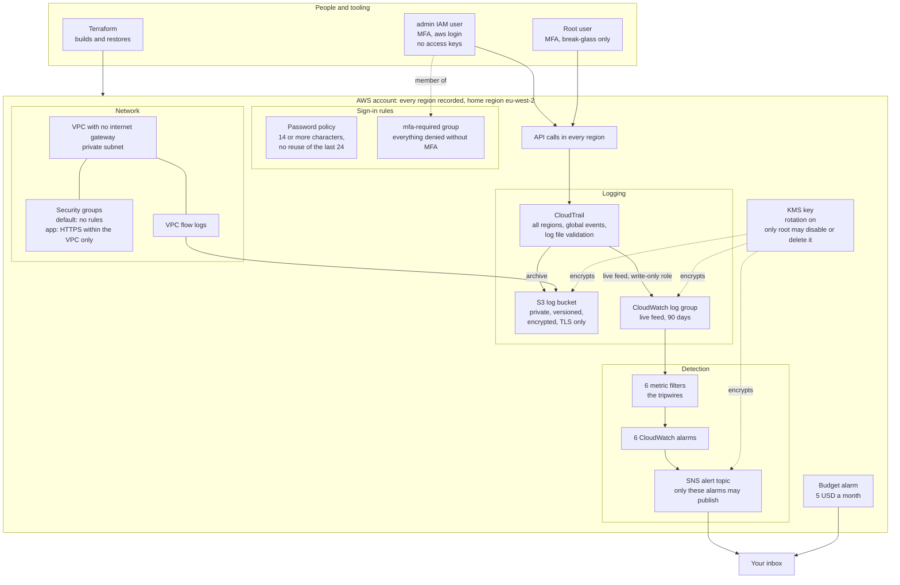
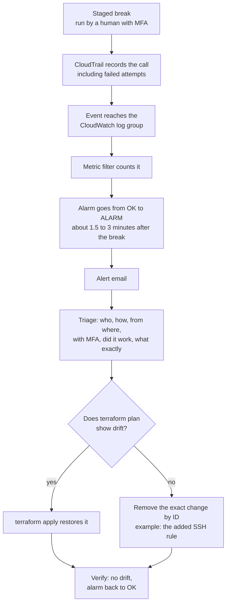

# Architecture

Two views of the same system: what is built and how a break is caught and
fixed.

## 1. What is built

Every API call in every region is recorded once, kept twice (an archive in S3
and a live, searchable copy in CloudWatch), watched by six tripwires, and
alerted by email. One KMS key locks the logs, the live copy and the alerts, and
only root may disable or delete it.

The six tripwires, each mapped to MITRE ATT&CK and proven by a staged break
(see [`../detections/README.md`](../detections/README.md)):

| Tripwire | Fires when | ATT&CK |
|---|---|---|
| CloudTrail tampering | logging stopped, trail deleted, reconfigured or narrowed | T1562.008 |
| S3 public access | public access blocks, bucket policy, ACL or ownership changed | T1530 |
| Security group changes | rules added, removed or modified | T1562.007 |
| Sign-in weakening | MFA removed, password policy changed, user removed from a group | T1556 |
| KMS key tampering | key disabled, deletion scheduled, rotation off, policy changed | T1485 |
| Root usage | any action as root, including signing in | T1078.004 |

Two things are deliberately outside Terraform: the budget alarm and the
`admin` user, because both had to exist before any code could run.

## 2. Break, detect, restore

How each staged break went, end to end. The branch at the bottom is the main
finding: Terraform only notices changes to what it manages, so a rule added on
top of a security group is invisible to it, and the detection is what catches it.

For the KMS key, blocking comes before detecting. Only root is allowed to turn the key off or delete it. If anyone else tries, AWS refuses. The key keeps working, so the alerts keep working too, and the failed attempt still sets off an alarm.